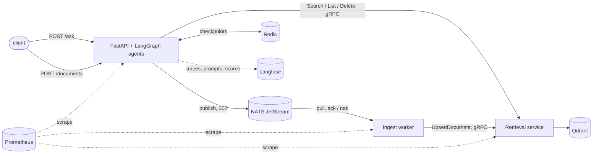
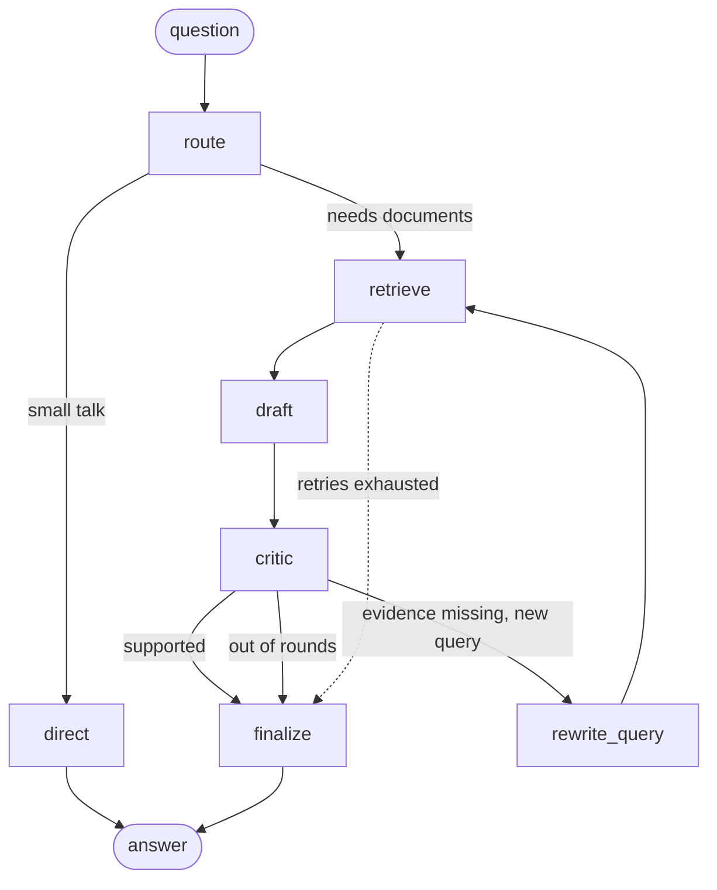

# Agentic Knowledge Pipeline

[](https://github.com/Kotoliji/agentic-knowledge-pipeline/actions/workflows/ci.yml)

Question answering over internal documents with a **LangGraph** agent graph that routes,
retrieves, drafts and checks its own answers before replying with citations. Around it:
a **gRPC** retrieval service that owns the vector store, asynchronous ingestion over
**NATS JetStream**, resumable runs checkpointed in **Redis**, tracing and prompt versioning
in **Langfuse**, an **LLM-as-judge** evaluation measured against human labels, and
**Prometheus/Grafana** metrics.

It is the successor of [knowledge-copilot](https://github.com/Kotoliji/knowledge-copilot),
a single-call RAG API: same problem, rebuilt as an agentic system that can be evaluated,
observed and operated.

## Architecture



### The agent graph



- **route**: decides whether the question needs the documents and writes a search query.
- **draft**: answers only from the retrieved passages, with structured output
  (`answer`, `citations`, `answerable`). Citation numbers are validated in code;
  an answer left without a valid citation is treated as unanswerable.
- **critic**: checks every claim against the cited passages. If evidence is missing,
  it proposes a new query and the graph searches again (bounded by `MAX_RETRIEVAL_ROUNDS`).
- **retrieve**: retries transient failures; when retries run out, an error handler
  routes to an explicit "search is unavailable" answer instead of failing the request.

## Results

All numbers come from files in [`evals/results/`](evals/results) and can be reproduced
with the commands below.

**Answers** (30 questions over a fictional company handbook, 6 of them not answerable
from the documents; agents on `gemini-3.1-flash-lite`, judge on `gemini-3.5-flash-lite`,
lexical embeddings at the time of the run):

| | |
|---|---|
| Correct | **29 / 30** (96.7%) |
| Faithful to the cited passages | **30 / 30** |
| Unanswerable questions declined | **6 / 6** |
| Runs where the critic triggered a second search | 5 |
| Keyword-matching baseline (no LLM), same dataset | 67% correct |

The one miss is the only question that needs inference rather than lookup
("hotel limit in Tokyo": the policy names four cities with a higher limit, so Tokyo gets
the default). The lite model declined; `gemini-3.5-flash` answered it correctly in a
manual run. The judge's verdicts are not yet compared with human labels for this run, so
treat the judge-based numbers as unvalidated until `agreement` is reported.

**Retrieval** (document-level, no LLM involved; 24 dataset questions plus 13 paraphrases
written to avoid the documents' wording):

| | lexical hashing | `bge-small-en-v1.5` (fastembed) |
|---|---|---|
| Dataset questions, recall@1 | 0.875 | **0.958** |
| Paraphrases, recall@1 | 0.462 | **0.846** |
| Paraphrases, recall@4 | 0.692 | **1.000** |
| Paraphrases, MRR | 0.552 | **0.897** |

With lexical retrieval, 4 of 13 paraphrased questions could not be answered at all:
the right document never reached the top 4.

## Where each technology is used

| | |
|---|---|
| **LangGraph** | The agent graph: typed state, conditional edges, a bounded critic loop, per-step retry policies and timeouts, a node error handler for graceful degradation, checkpointing. |
| **LangChain** | Chat models behind one interface (Gemini or Claude, chosen per role in config), prompt templates, native structured outputs, a `BaseRetriever` over the gRPC service, a shared rate limiter. |
| **Langfuse** | One trace per request with every node, retrieval and generation nested; token usage and cost; prompts fetched by label and linked to each generation; judge and human scores on the eval traces. |
| **LLM-as-judge** | Grades correctness (against a reference) and faithfulness (against the cited passages only), with a labelling CLI and Cohen's kappa for judge-vs-human agreement. |
| **gRPC** | `RetrievalService` is the single owner of the vector store, used by the graph, the API and the ingest worker. Deadlines, retries on `UNAVAILABLE` only, status codes mapped to typed errors, standard health service. |
| **NATS JetStream** | Asynchronous ingestion: ack after storing, nak with backoff on transient failures, a dead-letter subject, de-duplication by `Nats-Msg-Id` plus idempotent upserts. |
| **Redis** | LangGraph checkpoints, so a failed run resumes from the failed step. |
| **Qdrant + fastembed** | Vector store and local ONNX sentence embeddings (no API quota). |
| **Prometheus + Grafana** | Request outcomes and latency, gRPC latency and codes, ingestion outcomes and queue lag, on a provisioned dashboard. |

## Reliability

- **Timeouts that hold**: every LLM step has a LangGraph wall-clock timeout on top of the
  SDK's own, after a live run stalled for 42 minutes on one call.
- **No retry multiplication**: SDKs retry transport errors; the graph only retries
  timeouts and unparseable structured output.
- **Resumable runs**: a failed `/ask` returns its `thread_id`; `POST /ask/{thread_id}/resume`
  continues from the failed step without re-running (or paying for) finished ones.
  Graph state holds only JSON-native data because the Redis checkpointer deliberately
  doesn't revive arbitrary classes from storage, which a test against real Redis caught.
- **Degradation over failure**: retrieval down gives a clear answer from `/ask` and 503
  from document endpoints; an LLM provider outage gives 502, a timeout 504.

## Running it

Everything runs without API keys using deterministic offline agents:

```bash
docker compose up -d --build --wait
sh scripts/smoke_test.sh                          # answer, checkpoint, decline, ingest, degrade
curl -X POST localhost:8000/ask -H 'content-type: application/json' \
     -d '{"question": "How many days per week can I work remotely?"}'
docker compose --profile monitoring up -d         # Prometheus :9090, Grafana :3000
```

For real models and tracing, copy `.env.example` to `.env` and set `LLM_PROVIDER`
(`google` with a free Gemini key, or `anthropic`), plus the Langfuse keys. Models can be
set per role (`MODEL_ROUTER`, `MODEL_ANSWER`, `MODEL_CRITIC`, `MODEL_JUDGE`).

### Evaluation

```bash
python -m akp.evaluation retrieval               # compare embedders, no LLM calls
python -m akp.evaluation run                     # answer and judge the dataset
python -m akp.evaluation run --resume RUN.jsonl  # continue after quota errors
python -m akp.evaluation label RUN.jsonl         # label answers yourself (judge hidden)
python -m akp.evaluation agreement RUN.jsonl     # judge vs human: agreement, kappa
python -m akp.prompt_sync                        # publish prompt changes to Langfuse
```

### Development

```bash
pip install -e ".[dev]"
pytest
```

Integration tests against real services are opt-in: `AKP_TEST_REDIS_URL`,
`AKP_TEST_NATS_URL`, `AKP_TEST_FASTEMBED=1`. CI runs all of them, plus a job that builds
the compose stack and runs the smoke test.

## Layout

```
src/akp/
  graph.py              agent graph (LangGraph)
  agents.py, prompts.py LLM agents, offline agents, prompt definitions
  retrieval.py          chunking, embeddings, Qdrant store, LangChain retriever
  retrieval_service.py  gRPC server and client       (proto/akp/rpc/retrieval.proto)
  ingestion.py          NATS publisher and ingest worker
  checkpoints.py        Redis / in-memory checkpointers
  observability.py      Langfuse tracing, prompt management, scores
  evaluation.py         LLM-as-judge, human labels, retrieval metrics
  metrics.py            Prometheus metrics
  api.py                FastAPI service
corpus/                 fictional "Halden Systems" handbook (demo data)
evals/                  datasets and published results
monitoring/             Prometheus config, Grafana provisioning and dashboard
```

The documents in `corpus/` describe a fictional company and exist only as demo and
evaluation data.
